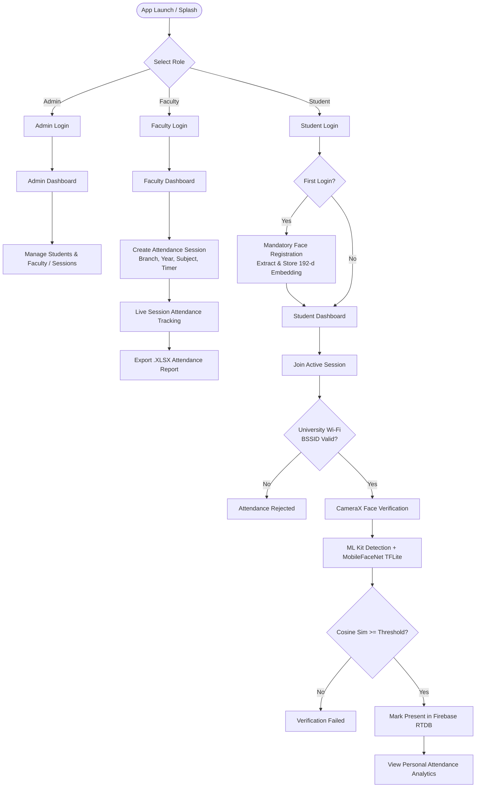

<p align="center">
  
</p>

# 📱 Smart Attendance System Using Face Recognition

An intelligent, secure, and automated attendance management Android application built with **Java**, **ML Kit Face Detection**, **MobileFaceNet (TensorFlow Lite)**, and **Firebase Realtime Database**.

---

## 🌟 Key Features

### 👨‍🎓 For Students
- **Biometric Face Verification:** Instant on-device facial recognition to mark attendance.
- **One-Time Registration:** Mandatory secure face capture and 192-d embedding extraction on first login.
- **Anti-Proxy Protection:** BSSID/institutional Wi-Fi validation combined with biometric match.
- **Attendance Records:** Subject-wise percentage, history, and status tracking.

### 👩‍🏫 For Faculty
- **Session Management:** Start attendance sessions with customizable auto-expiration timers (15m, 30m, 45m, 1h).
- **Real-Time Tracking:** Live counter of present students updating as they scan.
- **Reports & Excel Export:** Generate and share `.xlsx` attendance reports on-device via Apache POI.

### 🛡️ For Administrators
- Student & Faculty record management.
- Active campus session monitoring and device authorization control.

---

## 📸 App Screenshots & Outputs

<details open>
<summary><b>Click to expand / collapse screenshot gallery</b></summary>
<br>

<table align="center">
  <tr>
    <td align="center"><b>🔐 Login</b></td>
    <td align="center"><b>👨‍🎓 Student Dashboard</b></td>
    <td align="center"><b>📷 Face Registration</b></td>
  </tr>
  <tr>
    <td></td>
    <td></td>
    <td></td>
  </tr>
  <tr>
    <td align="center"><b>✅ Face Verification</b></td>
    <td align="center"><b>📝 Presence Recorded</b></td>
    <td align="center"><b>👨‍🏫 Take Attendance</b></td>
  </tr>
  <tr>
    <td></td>
    <td></td>
    <td></td>
  </tr>
  <tr>
    <td align="center"><b>⏱️ Active Session</b></td>
    <td align="center"><b>📊 Attendance Report</b></td>
    <td align="center"><b>📈 Student Analytics</b></td>
  </tr>
  <tr>
    <td></td>
    <td></td>
    <td></td>
  </tr>
</table>

</details>

---

## 🗂️ Project Structure

```text
Smart_Attendance_System/
├── app/
│   ├── src/main/
│   │   ├── AndroidManifest.xml
│   │   ├── assets/
│   │   │   └── mobilefacenet.tflite          # Pre-trained 192-d face embedding model
│   │   ├── java/com/example/smart_attendance_system/
│   │   │   ├── adapters/                     # RecyclerView adapters (Students, Faculty, Reports)
│   │   │   ├── data/                         # Data models (Student, Faculty, Session, Record)
│   │   │   ├── services/                     # Background services (SessionAutoCloseService)
│   │   │   ├── ui/
│   │   │   │   ├── admin/                    # Admin dashboard & management activities
│   │   │   │   ├── auth/                     # Role-based login & password recovery
│   │   │   │   ├── common/                   # Splash, CameraX & Face Registration/Verification
│   │   │   │   ├── faculty/                  # Session creation, live tracking & report exports
│   │   │   │   └── student/                  # Attendance scanning, confirmation & analytics
│   │   │   └── utils/                        # ML Kit, TFLite inference, Wi-Fi & Device utils
│   │   └── res/                              # Layout XMLs, drawables, animations & styles
│   └── build.gradle
├── gradle/wrapper/                           # Gradle 8.7 wrapper distribution
├── build.gradle                              # Root AGP 8.6.1 configuration
└── README.md
```

---

## 🔄 Application Flow



---

## 🛠️ Tech Stack & Specifications

- **Target / Compile SDK:** Android 15 (API 35) • **Min SDK:** Android 8.0 (API 26)
- **Computer Vision:** Google ML Kit Face Detection (`16.1.7`) + CameraX (`1.4.0`)
- **Deep Learning Inference:** TensorFlow Lite (`2.17.0`) with MobileFaceNet (192-d vectors)
- **Backend & Auth:** Firebase BoM (`35.2.0`) Realtime Database & Authentication
- **Export Engine:** Apache POI (`5.3.0`) for Excel (`.xlsx`) generation

---

## ⚙️ Quick Start

1. **Clone the repo:**
   ```bash
   git clone https://github.com/Vishva1605/Smart_Attendance_System_Using_FaceRecognition.git
   ```
2. **Add Firebase configuration:**
   - Place your `google-services.json` inside the `app/` folder.
3. **Build & Run:**
   - Open in **Android Studio** (Koala / Ladybug or newer recommended with JDK 17+).
   - Sync Gradle and run on a camera-enabled device (API 26+).

---

## 📄 License
This project is licensed under the [MIT License](LICENSE).
