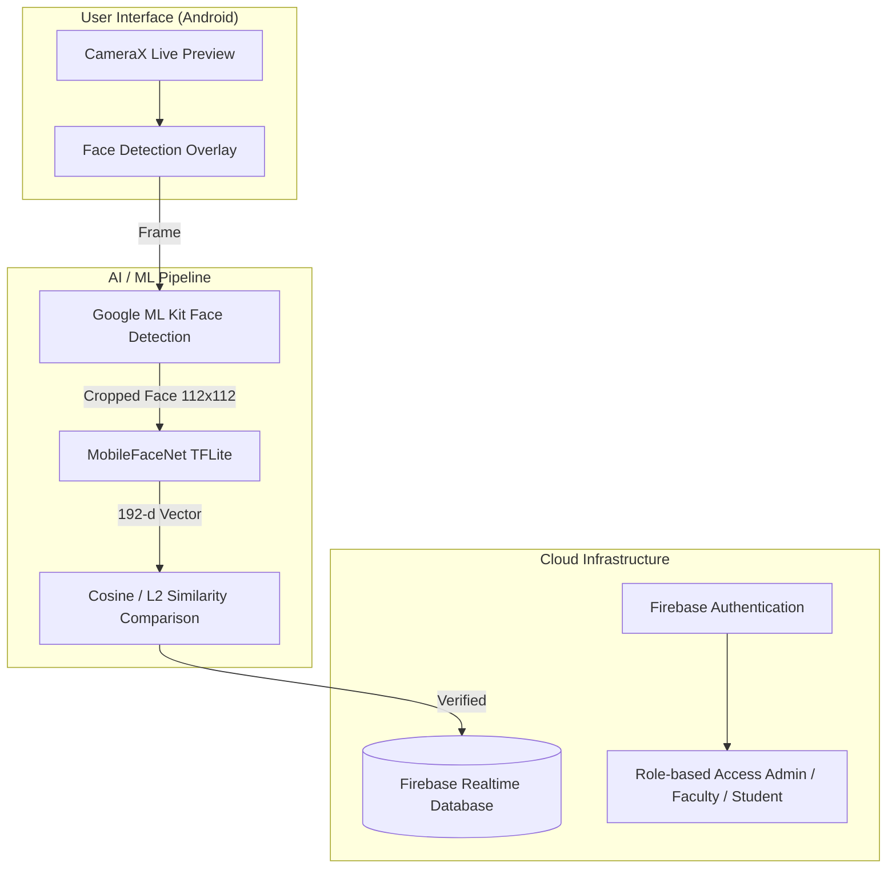

# 📱 Smart Attendance System Using Face Recognition (Android)

An intelligent, secure, and automated attendance management Android application built with **Java**, **ML Kit Face Detection**, **MobileFaceNet (TensorFlow Lite)**, and **Firebase Realtime Database**.

---

## 🌟 Key Features

### 👨‍🎓 For Students
- **Biometric Face Verification:** Mark attendance instantly using on-device facial recognition.
- **One-Time Registration:** Mandatory secure face capture and vector embedding during first-time onboarding.
- **Anti-Spoofing & Geofencing / Network Checks:** Verifies proximity or authorized institutional WiFi BSSID network to prevent proxy marking.
- **Personal Attendance Reports:** View subject-wise attendance percentages, dates, and attendance records.

### 👩‍🏫 For Faculty
- **Session Creation:** Select Branch, Year, Section, and Subject with customizable auto-expiration timers (15 mins, 30 mins, 45 mins, 1 hour, or open).
- **Live Attendance Monitoring:** Real-time visibility into students marking presence as they verify their face.
- **Reports & Analytics:** Filter and inspect attendance sessions across dates and subjects.
- **Excel Export:** Generate detailed `.xlsx` attendance sheets directly on device using Apache POI.

### 🛡️ For Administrators
- Manage faculty and student directories.
- Monitor active sessions across campus departments.
- Reset credentials and device bindings.

---

## 🏗️ Architecture & Technology Stack



### Tech Stack Details
- **Platform:** Android (Min SDK: 26 / Target SDK: 35 — Android 15 ready)
- **Language:** Java 8+
- **Machine Learning & Vision:**
  - Google ML Kit Face Detection (`16.1.7`)
  - TensorFlow Lite (`2.17.0`) with MobileFaceNet (192-dimensional embeddings)
  - CameraX (`1.4.0`)
- **Backend & Cloud:**
  - Firebase BoM (`35.2.0`)
  - Firebase Realtime Database
  - Firebase Authentication
- **Export & Storage:** Apache POI (`5.3.0`) for Excel (`.xlsx`) generation

---

## ⚙️ Project Setup & Installation

### Prerequisites
- **Android Studio** Ladybug / Koala Feature Drop (`2024.2+`) or higher.
- **JDK:** Version 17 (recommended for Gradle 8.7+).
- **Gradle:** 8.7+ (configured via Gradle Wrapper).
- A Firebase project with **Email/Password Authentication** and **Realtime Database** enabled.

### Steps
1. **Clone the repository:**
   ```bash
   git clone https://github.com/Vishva1605/Smart_Attendance_System_Using_FaceRecognition.git
   cd Smart_Attendance_System_Using_FaceRecognition
   ```

2. **Add `google-services.json`:**
   - Download `google-services.json` from your Firebase Console.
   - Place it inside the `app/` directory:
     ```
     app/google-services.json
     ```

3. **Configure Database Rules:**
   - Refer to `rules.json` for Realtime Database security rules.

4. **Build & Run:**
   - Open the project in Android Studio.
   - Sync Gradle files.
   - Run on an Android device or emulator with camera support (API 26+).

---

## 🔄 Recent Updates & Improvements (v2.0)
- **Target SDK Upgrade:** Upgraded from Android 14 (`compileSdk 34`) to Android 15 (`compileSdk 35`, targetSdk 35).
- **Modern Build System:** Upgraded to Android Gradle Plugin `8.6.1` and Gradle `8.7`.
- **Dependency Refresh:**
  - Upgraded Firebase BoM to `35.2.0`.
  - Upgraded ML Kit Face Detection to `16.1.7`.
  - Upgraded CameraX to `1.4.0`.
  - Upgraded AndroidX AppCompat to `1.8.0`, Material Components to `1.14.0`, and RecyclerView to `1.4.0`.
  - Upgraded Apache POI to `5.3.0`.
- **Storage & Security Permissions:** Configured modern Android 13+ granular media permissions (`READ_MEDIA_IMAGES`) and capped legacy storage permissions.
- **Modern Lifecycle Handling:** Migrated back press behavior to `OnBackPressedDispatcher`.
- **Resource Management:** Added explicit lifecycle cleanup for TensorFlow Lite interpreter instances to eliminate memory leaks.

---

## 📄 License
This project is licensed under the [MIT License](LICENSE).
